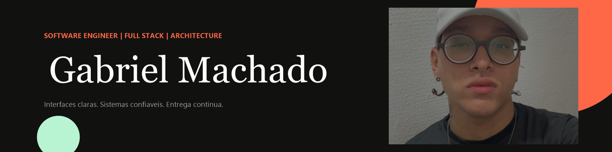

<p align="center">
  
</p>

<h1 align="center">Portfolio Gabriel Machado</h1>

<p align="center">
  Engenharia de software, arquitetura e desenvolvimento Full Stack apresentados em uma experiência rápida, acessível, instalável e preparada para produção.
</p>

<p align="center">
  <a href="https://portfoliodegabriel.netlify.app/"><strong>Acessar portfólio</strong></a>
  ·
  <a href="https://www.linkedin.com/in/gabriel-silva-machado-989781333/">LinkedIn</a>
  ·
  <a href="mailto:gabrielsolucoesemsoftware@gmail.com">Contato</a>
</p>

<p align="center">
  
  
  
  
  <a href="https://github.com/GabrielDS02/portfolio-gabriel/actions/workflows/ci.yml"></a>
  <a href="LICENSE"></a>
</p>

## Visão do produto

Este repositório não é apenas uma vitrine visual. Ele demonstra como uma experiência de apresentação pode ser construída com a mesma disciplina aplicada a um produto: conteúdo estruturado, componentes reutilizáveis, performance mensurável, acessibilidade, segurança, testes e entrega contínua.

O site conduz a pessoa visitante por uma narrativa completa:

1. posicionamento profissional claro;
2. case principal da plataforma Alcateia do Ensino;
3. projetos reais com contexto, tecnologias e acesso ao produto;
4. stack técnica e processo de trabalho;
5. contato direto por WhatsApp, LinkedIn ou e-mail.

## Destaques

- Angular standalone com TypeScript em modo estrito.
- Conteúdo e links centralizados para facilitar evolução.
- Português, inglês e espanhol com detecção e persistência de idioma.
- Tema claro/escuro com preferência do sistema e persistência local.
- PWA instalável, cache de app shell e suporte offline para assets.
- SEO técnico com Open Graph, Twitter Cards, JSON-LD, sitemap e robots.
- Imagens com carregamento sob demanda e dimensões explícitas.
- Animações progressivas com suporte a `prefers-reduced-motion`.
- Navegação por teclado, skip link, foco visível e semântica estruturada.
- Deploy contínuo e Deploy Previews preparados para Netlify.
- CI, CodeQL, revisão de dependências e atualizações via Dependabot.

## Stack

| Área      | Tecnologia                                         |
| --------- | -------------------------------------------------- |
| Aplicação | Angular 22.2, RxJS, TypeScript                     |
| Interface | Tailwind CSS 4.3, CSS responsivo e design tokens   |
| PWA       | Angular Service Worker, Web App Manifest           |
| Qualidade | ESLint, Prettier, Vitest, Angular strict templates |
| Entrega   | Netlify, GitHub Actions, Deploy Previews           |
| Segurança | CSP, headers HTTP, CodeQL, Dependabot              |

## Arquitetura

```text
src/app/
├── components/          # Seções visuais isoladas e reutilizáveis
├── core/
│   ├── data/            # Conteúdo, links, projetos e traduções
│   ├── models/          # Contratos tipados do domínio
│   └── services/        # Tema, idioma, SEO e instalação PWA
├── shared/directives/   # Comportamentos visuais reutilizáveis
├── app.ts               # Composição e interações globais
└── app.html             # Estrutura principal da experiência
```

Adicionar um novo projeto normalmente exige apenas uma entrada tipada em [`portfolio.data.ts`](src/app/core/data/portfolio.data.ts). Os filtros, cards e traduções reutilizam automaticamente a mesma estrutura.

## Executar localmente

### Requisitos

- Node.js 22 LTS ou versão compatível declarada em `package.json`;
- npm 10 ou superior.

### Instalação

```bash
git clone https://github.com/GabrielDS02/portfolio-gabriel.git
cd portfolio-gabriel
npm ci
npm start
```

Abra `http://localhost:4200`.

### Comandos

| Comando                | Finalidade                        |
| ---------------------- | --------------------------------- |
| `npm start`            | Servidor de desenvolvimento       |
| `npm run build`        | Build otimizado de produção       |
| `npm test`             | Testes automatizados              |
| `npm run lint`         | Análise estática                  |
| `npm run format:check` | Validação de formatação           |
| `npm run check`        | Lint, testes e build em sequência |

## Deploy no Netlify

O arquivo [`netlify.toml`](netlify.toml) define build, diretório publicado, fallback da SPA, cache e headers de segurança.

Para habilitar entrega contínua:

1. conecte o repositório ao projeto existente no Netlify;
2. selecione a branch `main` como produção;
3. mantenha Deploy Previews habilitados para Pull Requests;
4. confirme o domínio `portfoliodegabriel.netlify.app` no projeto correto.

Cada merge na `main` produzirá um novo deploy de produção. Pull Requests recebem uma URL de preview antes do merge.

## Segurança e privacidade

- Nenhum segredo ou token deve ser salvo no repositório.
- O site não publica endereço residencial nem data de nascimento.
- Vulnerabilidades devem ser relatadas pelo processo descrito em [`SECURITY.md`](SECURITY.md).
- A Content Security Policy e os demais headers estão centralizados no `netlify.toml`.

## Contribuição

Leia [`CONTRIBUTING.md`](CONTRIBUTING.md) antes de abrir uma mudança. Ao participar, você concorda com o [`CODE_OF_CONDUCT.md`](CODE_OF_CONDUCT.md).

## Versões

As mudanças são registradas em [`CHANGELOG.md`](CHANGELOG.md). A reconstrução Angular corresponde à linha `2.x` do projeto.

## Licença

Distribuído sob a [Licença MIT](LICENSE). O conteúdo pessoal, a fotografia e a identidade de Gabriel Machado permanecem vinculados ao seu autor e não devem ser usados para representar outra pessoa.

---

<p align="center">Projetos reais. Decisões explicáveis. Engenharia de ponta a ponta.</p>
